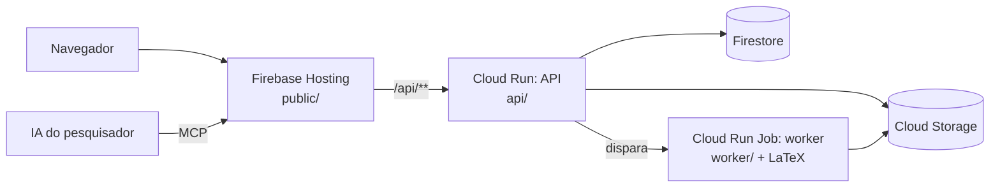

# Scriptorium MPIE

[](https://github.com/marceloloiro100cm-netizen/paper-orchestra-cloud/actions/workflows/check.yml)
[](LICENSE)
[](CHANGELOG.md)

**Escrita acadêmica guiada, com as fontes do próprio pesquisador.**
Produto técnico-tecnológico do Mestrado Profissional em Informática na Educação (MPIE), IFRS *Campus* Porto Alegre.

- **Site:** https://scriptoriummpie.web.app
- **Documentação:** [docs/](docs/README.md)
- **Como citar:** [CITATION.cff](CITATION.cff) (botão *Cite this repository* do GitHub)
- **In English:** [summary below](#in-english)

O Scriptorium ajuda estudantes a construir um artigo, TCC ou dissertação a partir das fontes que eles mesmos reuniram. A IA ajuda a ler e a escrever, mas o sistema confere cada entrega: as citações precisam existir nas fontes, as referências precisam ser confirmadas e o PDF final só sai quando tudo foi conferido.

> O Scriptorium não certifica resultados científicos. Revise referências, citações e afirmações antes de divulgar qualquer texto.

## O que ele faz

| Área | O que a pessoa encontra |
|---|---|
| **Guia de escrita** | Passo a passo em 8 etapas, do tema à submissão, para artigo ou projeto de pesquisa. Funciona sem login e salva no próprio aparelho. Ver [Guia](docs/funcionalidades/GUIA.md). |
| **Biblioteca** | Envio de PDF, DOCX, BIB, RIS e TXT; importação do Zotero e de DOIs de acesso aberto; fichamento por página; duplicatas; resumo PRISMA; checagem de citações. |
| **Escrita com a sua IA (MCP)** | A IA que o pesquisador já usa (Claude, Gemini, ChatGPT…) conecta ao Scriptorium com uma chave pessoal. O Scriptorium entrega trechos das fontes, controla a ordem das etapas e confere cada entrega, sem chamar modelo pago. Ver [MCP](docs/funcionalidades/MCP.md). |
| **Escrita com chave Gemini** | O motor [PaperOrchestra](https://github.com/google-research/paper-orchestra) roda no servidor com a chave Gemini de quem gera. Oculto no site desde 25/11/2026; o código continua mantido. |
| **Normas** | ABNT (artigo, TCC, dissertação) e APA 7. Cada norma é uma pasta em [`formatos/`](formatos/README.md): uma norma nova não exige código. |
| **Conferência** | Referências em três níveis (confirmada, sugerida, a conferir); retratações na Crossref; citações literais procuradas nas fontes; trava do PDF final. |
| **Orientação** | Link temporário para o orientador ler o andamento e comentar por etapa, sem criar conta; pacote de orientação em .zip. |
| **Pedagogia** | Tutor socrático, rubrica 0–15, modos de autonomia e declaração de uso de IA conforme a IN IFRS 16/2026. |
| **Exportação** | PDF (LaTeX), Word (.docx), matriz de evidências (CSV), referências em CSL-JSON e ABNT. |

## Como usar

1. Abra https://scriptoriummpie.web.app e entre com a conta Google. O acesso é por convite; quem não tem convite pode pedir pelo próprio site.
2. Envie suas fontes para a **Biblioteca**.
3. Em **Novo artigo**, escolha o tipo de trabalho, a norma e as fontes.
4. Conecte a sua IA em **Minha conta → Conectar sua IA**.
5. Siga as etapas. Antes de compilar, confirme ou corrija as referências marcadas como "a conferir".

O **Guia de escrita** (botão no topo do site) pode ser usado antes de tudo isso, sem login.

## Como funciona



Site e Guia em `public/`, API FastAPI em `api/`, trabalho pesado (fontes, bibliografia, PDF) em `worker/`, tudo no projeto Google Cloud `paperorchestra-mestrado`, região São Paulo. O navegador nunca acessa o banco diretamente. Detalhes, modelo de dados e segurança: [docs/ARQUITETURA.md](docs/ARQUITETURA.md). Termos próprios (etapa, cabeça, passe): [docs/GLOSSARIO.md](docs/GLOSSARIO.md).

## Organização do repositório

```
api/                 API FastAPI: login, biblioteca, servidor MCP, projetos, orientação, exportações
worker/              Cloud Run Job: leitura das fontes, bibliografia, compilação LaTeX, PaperOrchestra
formatos/            normas de formatação, uma pasta por norma
public/              site (index.html, app.js) e Guia de escrita (public/guia/)
tests/               testes sem rede e sem custo, um arquivo por assunto
scripts/             implantação, IAM, orçamento, backup, avaliação da busca, upstreams
docs/                documentação (índice em docs/README.md)
  funcionalidades/   como cada parte funciona para quem usa
  operacao/          backup, IAM e políticas de operação
  pesquisa/          protocolo do PTT e estudo piloto
  historico/         registros de decisões já concluídas
.github/             workflows, modelos de issue e de PR, Dependabot
```

## Desenvolvimento

```bash
python -m pip install requests fastapi google-api-core "PyMuPDF>=2.1,<3" "numpy>=1.26,<3" "mcp>=2.3,<3"
python -m unittest discover -s tests -v
python scripts/upstreams.py check
```

Branch → PR → CI → merge em `main` → deploy automático. O passo a passo está em [CONTRIBUTING.md](CONTRIBUTING.md), e o que cada workflow faz está em [docs/WORKFLOWS.md](docs/WORKFLOWS.md). Para colocar uma cópia no ar num projeto próprio: [docs/IMPLANTACAO.md](docs/IMPLANTACAO.md).

Toda origem externa (bibliotecas, APIs, normas) está registrada em [`docs/upstreams.json`](docs/upstreams.json), com licença e versão fixada; o CI falha se o código divergir do registro.

## Segurança e dados

- Cada rota da API confere o login Google (com `email_verified`) e o convite da conta.
- As regras do Firestore negam todo acesso direto do navegador; o banco tem proteção contra exclusão e backups diário e semanal.
- Chaves de conexão do MCP ficam só como hash; chaves Gemini ficam no Secret Manager. `public/config.js` tem só a configuração pública do Firebase.
- Nunca coloque manuscritos, dados de pesquisa ou credenciais em commits, issues ou logs.

Para relatar uma falha, siga o [SECURITY.md](SECURITY.md).

## Limitações conhecidas

- Os modelos ABNT e APA 7 são rascunhos: não garantem conformidade com NBR 6022, 10520, 6023 nem com o manual da instituição ou da revista.
- A conferência automática não prova que uma fonte existe, que um DOI está certo ou que uma afirmação é verdadeira; ela aponta o que precisa de leitura humana.
- A qualidade do texto depende da IA de cada pesquisador.

## Contribuir

Correções, normas novas e relatos de uso são bem-vindos: veja [CONTRIBUTING.md](CONTRIBUTING.md) e o [Código de Conduta](CODE_OF_CONDUCT.md). Para problemas e sugestões, abra uma [issue](https://github.com/marceloloiro100cm-netizen/paper-orchestra-cloud/issues/new/choose).

## In English

**Scriptorium** is an open-source tool for guided academic writing, built as the technical-technological product of a professional master's degree in Computing in Education (MPIE) at the Federal Institute of Rio Grande do Sul (IFRS), Brazil.

Students write articles, theses and dissertations from the sources they collected themselves. The researcher's own AI assistant (Claude, Gemini, ChatGPT…) connects through the **Model Context Protocol (MCP)** and does the reading and writing, while Scriptorium stores the sources, hands out page-level excerpts, checks every step (literal quotes must exist in the sources, references must be confirmed) and only releases the final PDF once everything has been checked. It also offers a writing guide in eight steps, a library with page-level reading notes, Brazilian ABNT and APA 7 formatting, an advisor review link and an AI-use statement.

- **Stack:** Firebase Hosting and Authentication, Cloud Run (FastAPI API and a Python + LaTeX worker), Firestore and Cloud Storage.
- **Docs:** in Portuguese, under [docs/](docs/README.md); start with [ARQUITETURA.md](docs/ARQUITETURA.md) (architecture) and [GLOSSARIO.md](docs/GLOSSARIO.md) (glossary).
- **Run the tests:** `python -m unittest discover -s tests` (no network, no keys, no cost).
- **License:** AGPL-3.0. **Cite:** see [CITATION.cff](CITATION.cff).

## Licença e créditos

Distribuído sob a **GNU Affero General Public License v3.0** ([LICENSE](LICENSE)). A licença acompanha o uso do PyMuPDF (AGPL-3.0) e garante que quem usa o site possa obter o código-fonte.

Baseado no [PaperOrchestra](https://github.com/google-research/paper-orchestra) (Google Research), que não é um produto Google oficialmente suportado. Demais créditos e licenças em [docs/UPSTREAMS.md](docs/UPSTREAMS.md).
