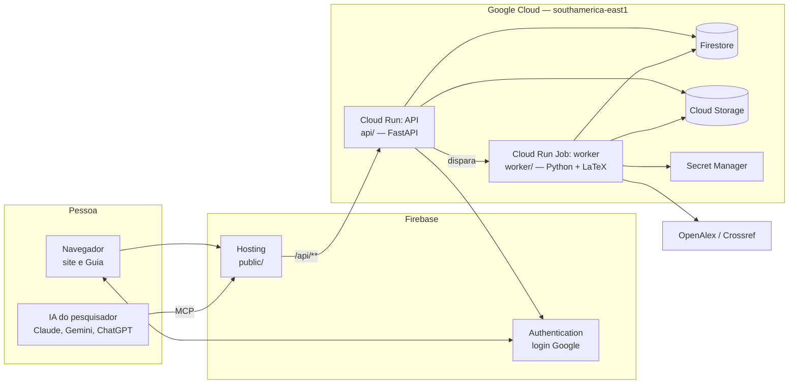
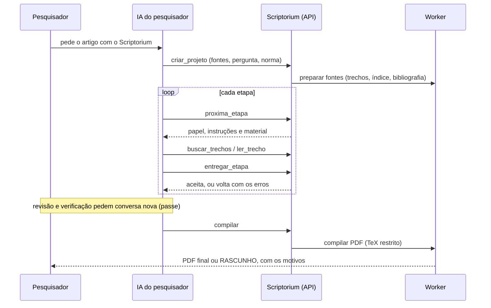

# Arquitetura

Visão de como o Scriptorium funciona por dentro. Para usar o sistema, comece pelo [README](../README.md); para os termos próprios do projeto (etapa, cabeça, passe), veja o [glossário](GLOSSARIO.md).

## Visão geral

| Peça | Pasta | Papel |
|---|---|---|
| **Site** | `public/` | Página única (`index.html` + `app.js`) e o Guia de escrita (`public/guia/`). Fala só com a API, nunca com o Firestore. |
| **API** | `api/` | FastAPI no Cloud Run (`paper-orchestra-api`). Confere login e convite, guarda biblioteca e projetos, serve o servidor MCP e dispara o worker. |
| **Worker** | `worker/` | Cloud Run Job (`paper-orchestra-worker`). Trabalho pesado e sem pressa: preparar fontes (texto, trechos, índice), montar a bibliografia, compilar o PDF e rodar o PaperOrchestra no modo com API. |
| **Normas** | `formatos/` | Uma pasta por norma (ABNT, APA 7…). A API, o worker, a exportação Word e o site leem daqui. |

O Firebase Hosting encaminha `/api/**` para a API (ver `firebase.json`), então site e API ficam no mesmo endereço.

## Os dois modos de escrita

### Modo sem API (MCP): o modo principal

A IA do próprio pesquisador se conecta ao Scriptorium pelo [Model Context Protocol](https://modelcontextprotocol.io) com uma chave de conexão pessoal. O Scriptorium **não chama modelo nenhum**: é acervo e cartório.

Detalhes das etapas, das ferramentas e das regras de independência: [funcionalidades/MCP.md](funcionalidades/MCP.md).

### Modo com API (Gemini)

O worker roda o [PaperOrchestra](https://github.com/google-research/paper-orchestra) com a chave Gemini pessoal de quem gera. Está **oculto no site desde 25/11/2026** (`API_MODE = false` em `public/app.js`), mas o código continua mantido e testado. Histórico das ondas V2 desse modo: [historico/IMPLANTACAO-2026-11.md](historico/IMPLANTACAO-2026-11.md).

## Dados

### Firestore

Só a API e o worker acessam, com Admin SDK. As regras (`firestore.rules`) negam tudo ao navegador.

| Coleção | Conteúdo |
|---|---|
| `research_members`, `research_access_requests` | convites e pedidos de acesso |
| `research_credentials` | metadados da chave Gemini de cada pessoa (a chave fica no Secret Manager) |
| `library_items` | itens da biblioteca (metadados, fichamento, notas) |
| `mcp_tokens` | chaves de conexão do MCP, guardadas só como hash SHA-256 |
| `mcp_projects`, `mcp_passes` | projetos do modo MCP e os passes para conversas novas |
| `research_jobs`, `research_owner_state` | trabalhos do worker e a trava de um trabalho ativo por conta |
| `advisor_authorizations` | autorizações do orientador (IN IFRS 16/2026) |

### Cloud Storage

Bucket privado `<projeto>-paper-storage`:

- `library/{uid}/`: arquivos enviados e dados derivados (trechos, índices, capas), descartáveis.
- `mcp/{uid}/{projeto}/`: fontes do projeto, referências, índice, entregas de cada etapa e `final/` (PDF, `.tex`, `.bib`, proveniência).
- pastas dos trabalhos do modo com API.

Backups: ver [operacao/BACKUP.md](operacao/BACKUP.md).

## Segurança

- **Login:** Firebase Authentication com Google. A API confere o ID token (inclusive `email_verified` e revogação) e o convite da conta em toda rota.
- **Banco:** regras do Firestore negam acesso direto; proteção contra exclusão do banco ativada; backups diário (7 dias) e semanal (12 semanas).
- **MCP:** a chave de conexão aparece uma vez; o Firestore guarda só o hash; no máximo 5 ativas por conta; vale 1 ano; revogável no site.
- **Link do orientador:** público e temporário (até 30 dias), com no máximo 50 apontamentos por projeto e 10 a cada 10 minutos.
- **LaTeX:** o texto vem de uma IA e é compilado com `-no-shell-escape` e leitura e escrita restritas ao diretório de trabalho; a API recusa comandos perigosos antes.
- **Documentos enviados:** inspeção estática, quarentena e remoção de instruções embutidas (`worker/document_guard.py`, `api/upload_guard.py`).
- **Segredos:** chaves Gemini e OpenAlex no Secret Manager. `public/config.js` tem só a configuração pública do Firebase.
- **Deploy:** GitHub Actions com Workload Identity Federation, sem chave JSON, restrito a este repositório e à branch `main`.
- **Dependências:** Dependabot, OSV-Scanner e o registro de upstreams (`docs/upstreams.json`).

## Mapa do código

### `api/`

| Arquivo | Responsabilidade |
|---|---|
| `main.py` | aplicação FastAPI, autenticação, rotas de conta e do modo com API |
| `access.py`, `access_requests.py`, `credentials.py`, `model_access.py` | convites, pedidos de acesso, chave Gemini, modelos permitidos |
| `library.py`, `library_index.py`, `library_search.py`, `upload_guard.py` | biblioteca, ficha de leitura, busca, proteção de envio |
| `zotero_import.py`, `oa_import.py` | importação do Zotero e de PDFs de acesso aberto |
| `mcp_server.py` | servidor MCP (ferramentas para a IA) |
| `mcp_flow.py`, `mcp_review.py`, `mcp_student.py` | etapas e conferências; revisão sistemática; visão do estudante |
| `mcp_site_api.py` | rotas do site para projetos MCP, chaves de conexão e link de orientação |
| `abnt_refs.py`, `apa_refs.py`, `csl_export.py`, `docx_export.py`, `pdf_render.py` | referências, exportações e páginas do PDF |
| `guide_api.py`, `advisor.py`, `pilot_eval.py` | Guia de escrita, perfil e orientação, avaliação do piloto |

### `worker/`

| Arquivo | Responsabilidade |
|---|---|
| `runner.py` | ponto de entrada do Job (decide o modo) |
| `mcp_jobs.py` | preparo das fontes e compilação do modo MCP |
| `source_materials.py`, `structured_extract.py`, `chunking.py`, `ocr_router.py` | leitura de PDF, DOCX e TXT em trechos com página |
| `lexical_index.py`, `embeddings.py`, `vector_index.py`, `reranker.py`, `retrieval_context.py` | busca nas fontes |
| `bib_integrity.py`, `reference_verification.py`, `editorial_status.py` | bibliografia, conferência e retratações |
| `quote_verification.py`, `evidence_matrix.py`, `audit_shield.py`, `scientific_audit.py`, `fire_audit.py` | citações, evidências e auditorias |
| `run_manifest.py`, `ai_declaration.py` | proveniência e declaração de uso de IA |
| `document_guard.py` | proteção contra instruções embutidas nos documentos |

Situação de cada módulo do plano V2 (M01–M27): [V2-MODULOS.md](V2-MODULOS.md).
